# Windows 11 Name-Resolution and Discovery Hardening Lab

## At a Glance

- **What:** Baseline and hardening of NetBIOS over TCP/IP, LLMNR and SSDP/UPnP on an isolated Windows 11 VM, verified with before/after configuration checks and packet captures.
- **Result:** On the default configuration, the VM sent NBNS and LLMNR queries after a lookup of a name DNS could not resolve. After hardening, the same tests showed none. SSDP was verified by configuration only, because the VM sent no SSDP traffic at baseline.
- **Method:** Host-side Wireshark captures with the trigger confirmed in each one, PowerShell and registry changes with a read-back after each, a restart, and a snapshot rollback.
- **Reproducibility:** I repeated the NetBIOS and LLMNR before/after tests on the reverted VM with the same outcome (see Repeat Run).
- **Tools:** VMware Workstation Pro, Windows 11 Pro, PowerShell, Wireshark 4.6.9.
- **Skills shown:** packet filtering and sender attribution, Windows service and policy hardening, before/after verification, and evidence sanitization.
- **Limits:** NetBIOS and LLMNR were each tested twice, with one capture per run; SSDP once. Windows Firewall and Defender not tested. DHCP, DNS and the guest isolation check were done once, after the revert, outside the main before/after comparison.
- **AI assistance:** I used an AI assistant to guide the order of steps and to review my screenshots for sensitive information. I ran every command myself and recorded every result.

| Area | Before (default) | After hardening |
|---|---|---|
| NetBIOS over TCP/IP | Enabled; 3 NBNS name queries from the VM | Disabled; 0 matching packets |
| LLMNR | No policy; 16 LLMNR-port packets, 8 of them queries for the test name from the VM | `EnableMulticast` = 0; 0 matching packets |
| SSDP / UPnP | SSDP Discovery running, UDP 1900 bound; no SSDP sent by the VM | Both services Disabled; no UDP 1900 rows; no SSDP sent by the VM (no change in traffic) |
| DHCP / DNS | Not part of the comparison; checked once after the revert (see Additional Tests) | Not applicable |

The NetBIOS and LLMNR results were reproduced in a second pass (see Repeat Run). Each run is one trigger in one capture. See Limitations.

## Sanitize First

Screenshots were reviewed for IP, MAC and IPv6 addresses, usernames, hostnames, file paths, device IDs and credentials before publishing. Obscured areas use solid fills, files are flat PNGs with metadata stripped, and raw `.pcapng` captures are kept private. Capture times and SHA-256 hashes are given in text instead. The host computer's name, which appeared in some captured LLMNR queries, is not published.

## Objective

- **Goal:** Baseline and harden NetBIOS over TCP/IP, LLMNR and SSDP/UPnP on a Windows 11 VM in an isolated lab, and verify each change with comparable before/after checks.
- **Scope:** One Windows 11 Pro VM on a Host-only network. DHCP and DNS were optional and were checked once on the reverted VM, outside the before/after comparison (see Additional Tests). Windows Firewall and Defender were out of scope and **not tested**.
- **Test design:** The VM started with default settings, so the as-found state is the "before". Hardening was then applied and the same configuration checks and captures repeated for the "after". Each pair used the same capture point, trigger, filter and approximate duration (about five minutes).

## Environment

- **Hypervisor:** VMware Workstation Pro 26H1u1 (26.0.1.25688693)
- **VM:** `[VM name redacted]`: 8 GB memory, 2 processors, 64 GB NVMe disk, virtual TPM
- **Guest OS:** Windows 11 Pro, version 26H2, OS build 26300.9457. Release channel (retail vs. preview): **not established**. The VM was not updated, because it is isolated.
- **Network:** one adapter, Host-only from creation; the VM never used another adapter mode. VMware's DHCP service is enabled on the Host-only network (VMnet1).
- **Capture point:** Wireshark 4.6.9 on the host, on VMware Network Adapter VMnet1, with no capture filter. Host OS: Windows 11 (26H1), build 28000. All capture timestamps use the host clock.
- **Guest commands:** Windows PowerShell inside the VM, with guest-side times on the VM clock. Time zone: Singapore Standard Time, unchanged from install.
- **Clock offset:** capture times are host-clock and guest command times are VM-clock. The VM clock was ahead of the host clock by different amounts in different sessions: about 16 hours (host about 11 PM on 2026-11-22 against VM 3 PM on 2026-11-23), then 5 h 21 min (host 11:02 AM against VM 4:23 PM on 2026-11-23), then about 16 hours again after the hardening restart (host 11:24 AM on 2026-11-23 against VM 3:23:54 AM on 2026-11-24). After the revert, the two clocks agree to within a few minutes. The cause of the changes is not established. Events were matched through the trigger packets and the snapshot order rather than through the clocks.
- **VMware Tools:** installed after the revert (see Cleanup), using Workstation's built-in option with default settings; time synchronization off.
- **Safety controls:** Host-only network, local dummy account (`labuser`), and a VMware snapshot `pre-hardening-baseline` taken 11/22/2026 10:26:54 PM (host clock) with the VM powered on.

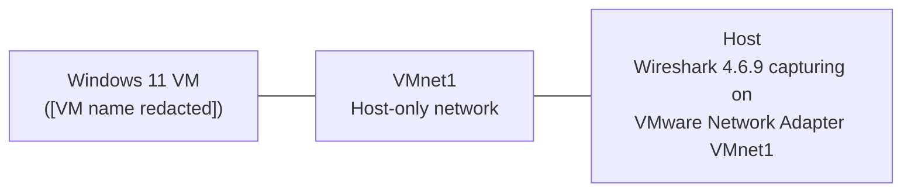

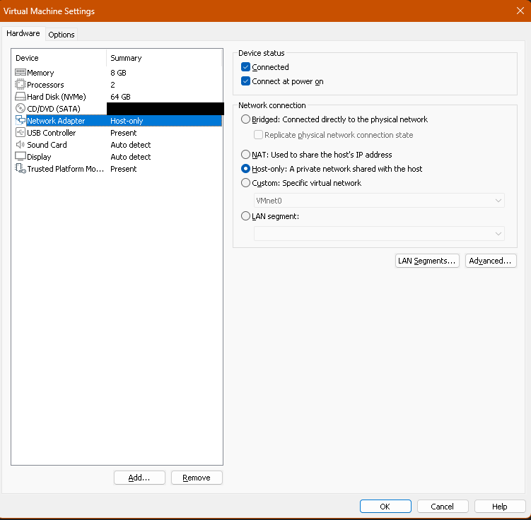
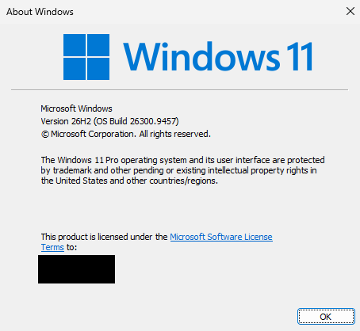
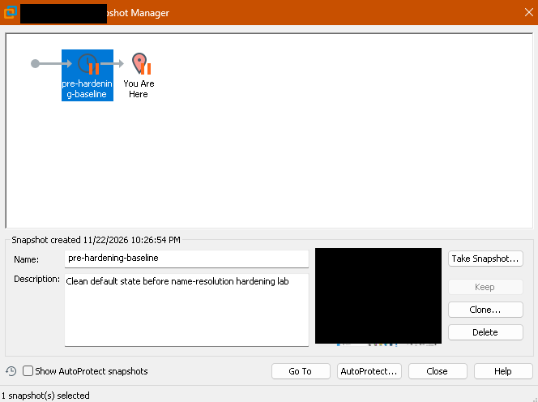

## Findings / Baseline (as found, default settings)

### Network isolation
- The adapter is set to Host-only, with one adapter listed. VM traffic is visible on VMnet1 in the host captures.
- No DNS responses were seen in any of the six captures below, even though the VM sent DNS queries. This supports isolation for those captures only.
- Reachability from inside the guest to the internet or home network was **not tested directly**.

### NetBIOS over TCP/IP
- **Configuration** (2026-11-23 2:53:27 PM, VM clock): `TcpipNetbiosOptions` = 0 (use the DHCP-supplied setting, the default); `ipconfig` reports NetBIOS over Tcpip **Enabled**. UDP 137 and 138 were bound by `System`, and TCP 139 was listening, owned by `System`.
- **Traffic test:**
  - Trigger: `ping -n 1 nbtest-host01` from the VM. The test name was in 20 of 222 packets, the first at packet No. 71 (about 73 s in).
  - Capture: 2026-11-22 22:56:36 to 23:02:18 (5 min 42 s), 0 packets dropped.
  - Filter: `nbns || nbdgm || nbss || udp.port == 137 || udp.port == 138 || tcp.port == 139`
  - Result: **3 of 222 packets matched.** All were NBNS name queries for `NBTEST-HOST01<00>`, sent by the VM to a broadcast address about 0.75 s apart.
  - DNS responses: 0.
  - SHA-256: `0acca4dca7c41a3eb8c153394231abf8ae61262f8fc1a461426d337f470e84ce`

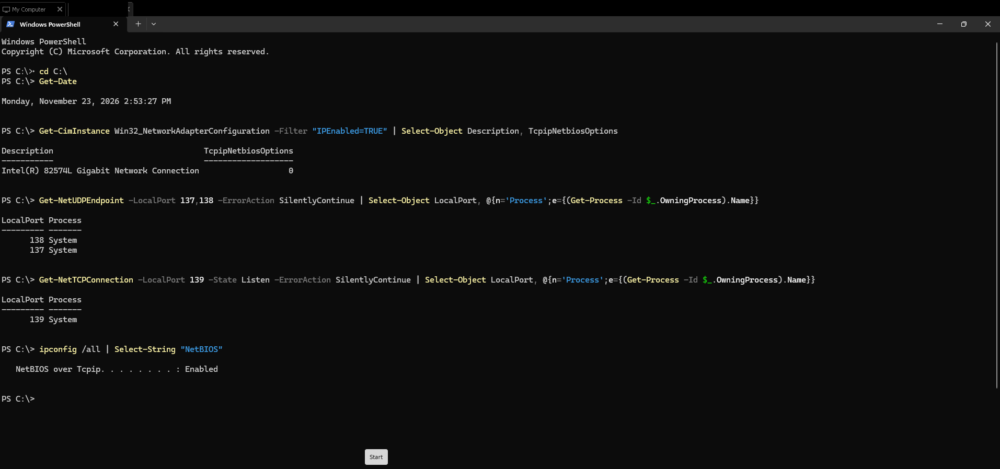
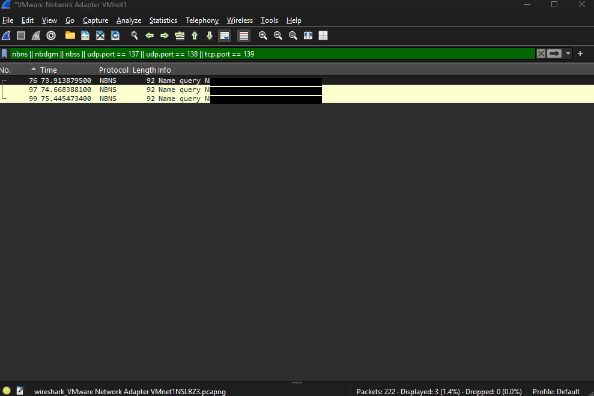
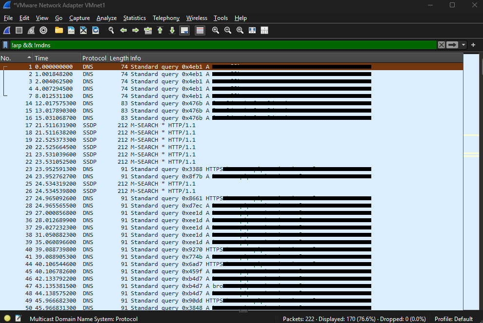

### LLMNR
- **Configuration** (2026-11-23 3:19:22 PM, VM clock): the `DNSClient` policy key was **not present**, so the Windows default applied. Dnscache was Running with startup type Automatic. UDP 5355 was bound by `svchost` (two rows). No TCP 5355 listener.
- **Traffic test:**
  - Trigger: `ping -n 1 llmnrtest-host01` from the VM at about 11:24 (host clock). The test name was in 23 of 193 packets, the first at No. 28 (about 37 s in).
  - Capture: 2026-11-22 23:23:10 to 23:29:01 (5 min 50 s), 0 packets dropped.
  - Filter: `llmnr || udp.port == 5355 || tcp.port == 5355`
  - Result: **16 of 193 packets matched.**
    - 8 were LLMNR queries for `llmnrtest-host01`, all sent by the VM over IPv4 and IPv6 (4 A and 4 AAAA, in two bursts about 0.42 s apart).
    - 8 were LLMNR queries for the host computer's name: 4 sent by the VM and 4 by the host's own VMnet1 adapter. Only some were inspected individually.
  - DNS responses: 0.
  - SHA-256: `950b1382bb43ae5a684216af0000957750fd175abcbf6513b78db9b951c872cc`

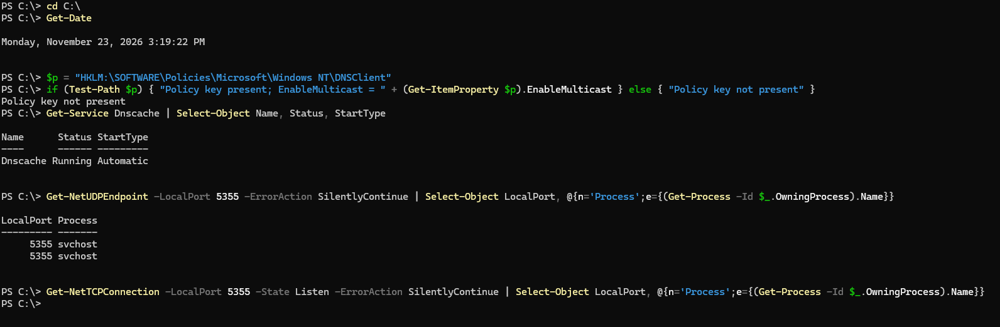
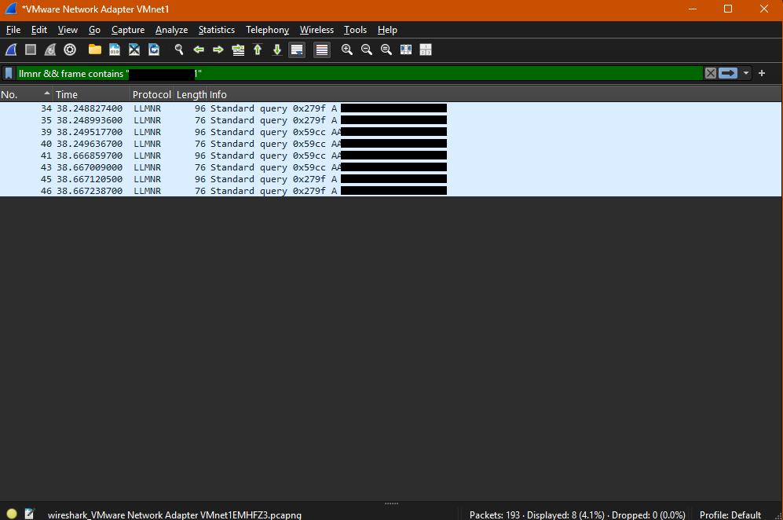

### SSDP / UPnP
- **Configuration** (2026-11-23 4:01:54 PM, VM clock): SSDP Discovery (SSDPSRV) Running / Manual; UPnP Device Host (upnphost) Stopped / Manual. UDP 1900 was bound by `svchost` (four rows). No TCP 2869 listener.
- **Traffic test (passive, VM idle, no trigger):**
  - Capture: 2026-11-23 10:43:27 to 10:48:49 (5 min 21 s), 127 packets, 0 dropped.
  - Filter: `ssdp`
  - Result: **12 of 127 packets matched.** All were `M-SEARCH * HTTP/1.1`, sent by the host's VMnet1 adapter, in three bursts of four packets about 120 s apart. **0 came from the VM.**
  - SHA-256: `f4e3ad3541d7b52387ac3901bf215b31c00e3d7b1543b59089f025e59f12dd09`

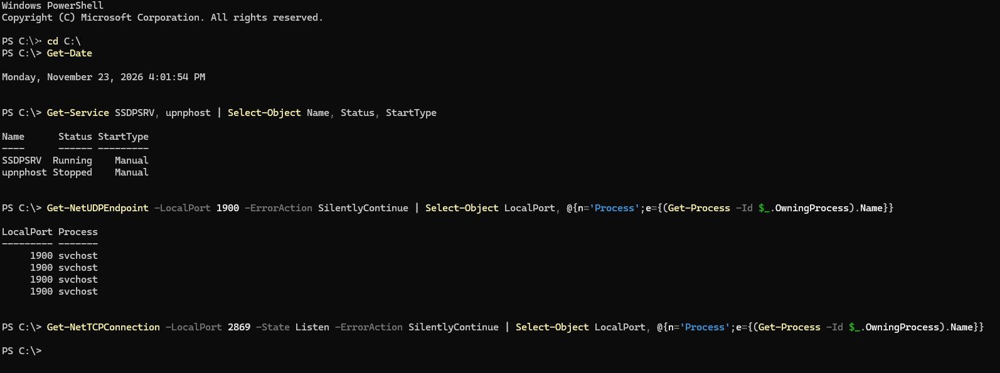
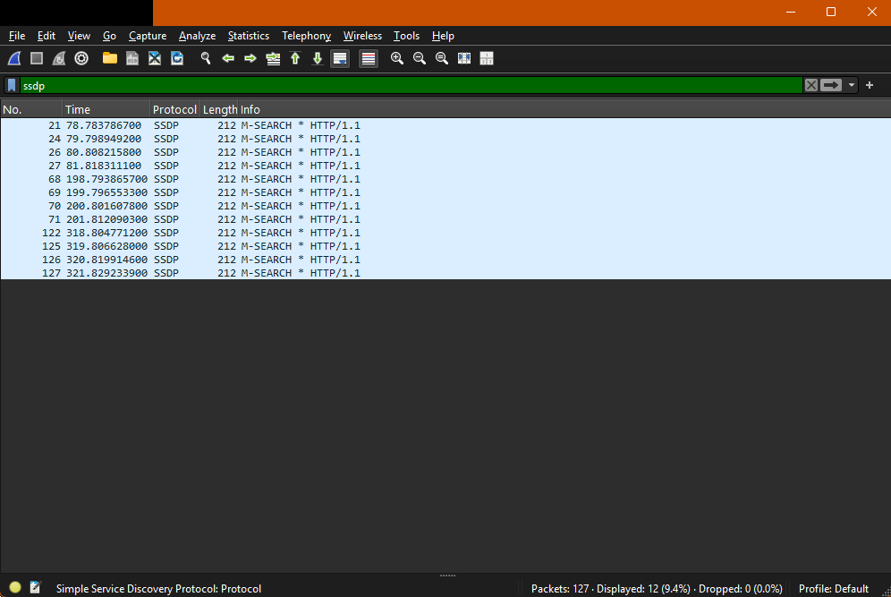

### DHCP and DNS
Not part of the baseline or the hardening comparison. A one-time check on the reverted VM is under Additional Tests.

## Action / Hardening

All changes were made inside the VM in elevated PowerShell (title: Administrator) after the snapshot was taken.

| Area | Change | Time (VM clock) | Read-back |
|---|---|---|---|
| NetBIOS over TCP/IP | `SetTcpipNetbios` with option 2 (disabled) | 4:27:44 PM | `ReturnValue` 0; `TcpipNetbiosOptions` = 2 |
| LLMNR | Created the `DNSClient` policy key and set `EnableMulticast` = 0 | 4:28:52 PM, re-applied 4:39:52 PM | 0 |
| SSDP / UPnP | Set SSDPSRV and upnphost to Disabled and stopped SSDPSRV | 4:30:25 PM | Stopped / Disabled |

The VM was restarted once after the changes so that they were fully applied. Two failed NetBIOS attempts and a mistaken undo command that removed the LLMNR value (re-applied at 4:39:52 PM) are documented in Appendix A.

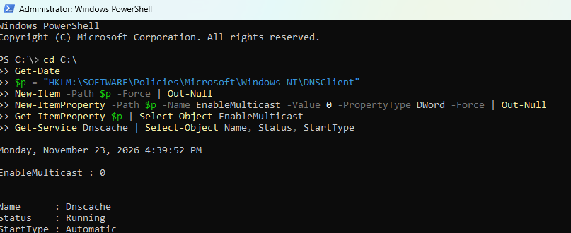

## Verification

### Configuration read-back after the restart (2026-11-24 3:23:54 AM, VM clock, except where noted)

| Item | Before | After |
|---|---|---|
| NetBIOS option / effective state | 0 / Enabled | 2 / Disabled |
| UDP 137, UDP 138, TCP 139 | Bound by System | No rows returned |
| LLMNR policy | Key not present | Key present, `EnableMulticast` = 0 |
| Dnscache | Running / Automatic | Running / Automatic |
| UDP 5355, TCP 5355 | UDP: two `svchost` rows | No rows returned |
| SSDPSRV / upnphost | Running / Manual, Stopped / Manual | Stopped / Disabled, Stopped / Disabled |
| UDP 1900, TCP 2869 | UDP 1900: four `svchost` rows | No rows returned |

The first after-state screenshot (NetBIOS, policy, Dnscache) does not show a timestamp. An empty listener result shows that nothing was bound at that moment, not that a port can never be used.

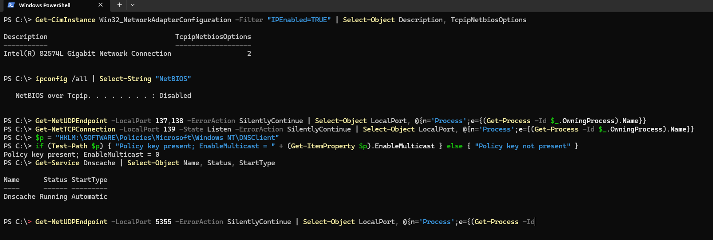
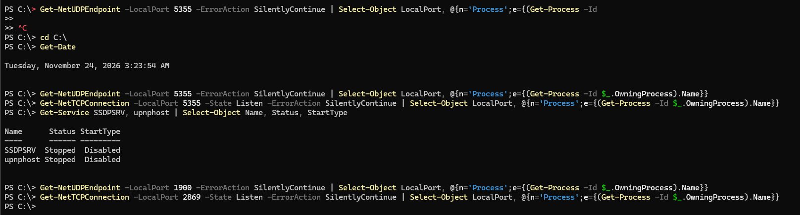

### Traffic after hardening (same capture point, trigger and filter as before)

| Area | Capture (host clock) | Trigger confirmed | Matches | Before |
|---|---|---|---|---|
| NetBIOS | 2026-11-23 11:26:47 to 11:31:57 (5 min 9 s), 145 packets | 15 packets contain `nbtest-host01`, first at No. 60 (about 42 s) | **0** | 3 NBNS name queries |
| LLMNR | 11:36:34 to 11:42:08 (5 min 34 s), 81 packets | 15 packets contain `llmnrtest-host01`, first at No. 29 (about 38 s) | **0** | 16 LLMNR-port packets |
| SSDP (passive) | 11:46:46 to 11:51:56 (5 min 9 s), 84 packets | No trigger | 12 `M-SEARCH`, all from the host adapter, **0 from the VM** | Same |

- DNS responses: 0 in each of the three after-captures.
- SHA-256 (NetBIOS): `0930ea1d079de2b1205163f44f059a50bd09b4dd29bf70f4cb52727366864db3`
- SHA-256 (LLMNR): `8c7652854105829f0037fff3d9bcdeb973d3d507d470a51cfb1bb7098eefb642`
- SHA-256 (SSDP): `98eed367bb06de78af818ca0faedaa0948ca2120ee989b6bda87708cc801cfaa`

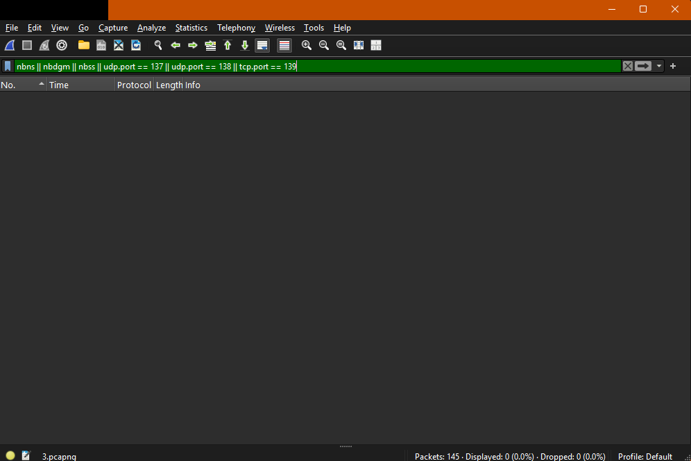
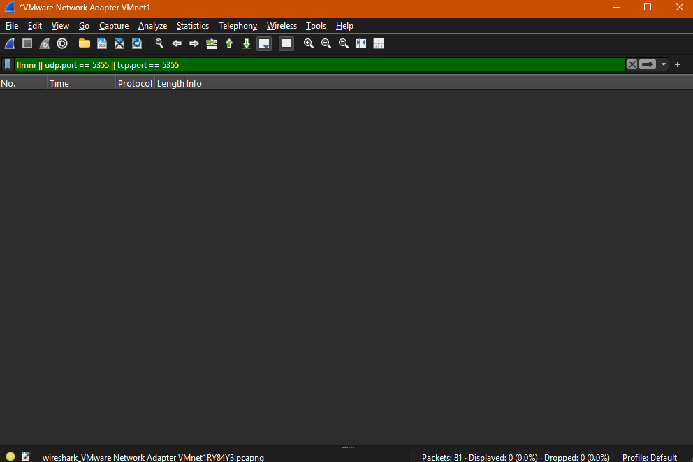
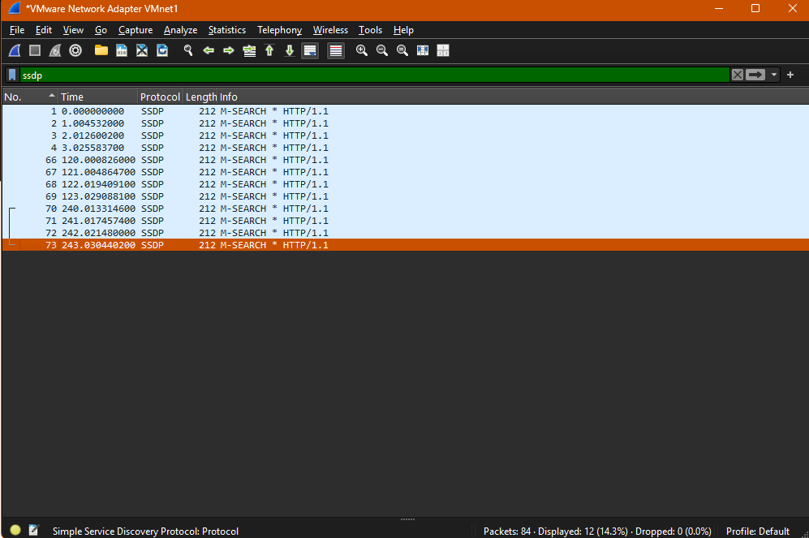

### Reading the results
- **NetBIOS and LLMNR:** the queries seen at baseline did not appear after hardening, with the trigger present in the capture each time. This is consistent with the changes working. It is one trigger in one capture and does not prove the traffic can never appear.
- **SSDP:** the VM sent no SSDP traffic before or after, so the captures show no change. The evidence for this area is the configuration read-back, not the traffic.

## Cleanup

The VM was reverted to the `pre-hardening-baseline` snapshot, finishing at about 4:08 PM (host clock). It came back powered off, although the snapshot was taken while it was running; the reason is not established. I powered it on and installed VMware Tools using Workstation's built-in option with default settings (time synchronization off). Snapshot Manager still listed `pre-hardening-baseline`, and the adapter was still Host-only.

A read-back at 2026-11-23 4:15:11 PM (VM clock), after the Tools install, showed the checked items matching the baseline: `TcpipNetbiosOptions` = 0 with NetBIOS over Tcpip Enabled, no `DNSClient` policy key, Dnscache Running / Automatic, SSDPSRV Running / Manual and upnphost Stopped / Manual. Because the read-back came after the Tools install, it does not isolate the effect of the revert alone. Listeners were not re-checked after the revert (**Not tested**).

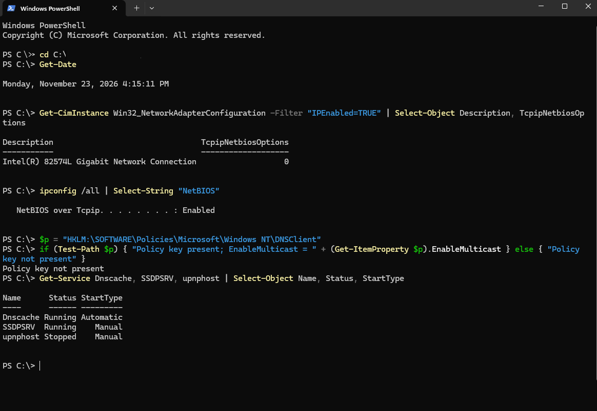

## Additional Tests (after the revert)

These checks ran on the reverted VM, with default settings and VMware Tools installed, so they are not part of the before/after hardening comparison. After the revert, the VM and host clocks agree to within a few minutes (for example, a VM reading of 6:47:01 PM against a host capture that started at 18:46:26).

### Guest isolation check
- **2026-11-24 11:55:26 AM (VM clock):** 0 IPv4 and 0 IPv6 default routes, and one active adapter, `Ethernet0`.
- This reads the routing table at one moment. It is not a connectivity test.

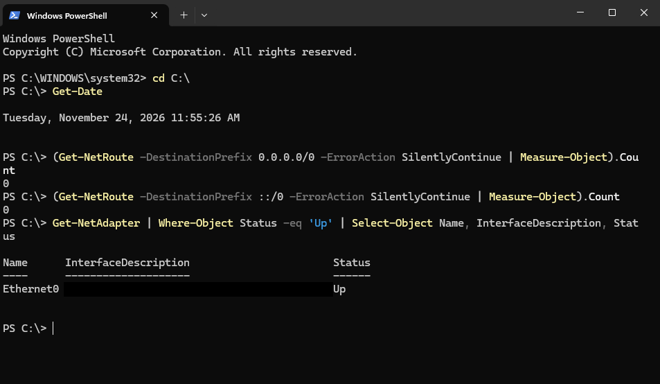

### DHCP
- **Configuration (11:56:49 AM, VM clock):** `Ethernet0` uses DHCP (`DHCP Enabled` = Yes). Lease obtained 11:49:11 AM, expires 12:19:11 PM (30 minutes). A later reading at 6:33:19 PM showed a lease obtained at 6:29:35 PM and expiring at 6:59:37 PM; I did not run a renewal before that reading.
- **Capture (host clock):** 2026-11-24 12:02:44 to 12:05:48 (3 min 4 s), 109 packets. A renewal was attempted during the capture, but its on-screen result was not recorded reliably, so the captured exchange is not attributed to it.
- **Filter `dhcp`:** **2 of 109 packets matched**, a DHCP Request and an ACK with the same transaction ID (`0x52f223c0`), about 78 s into the capture.
- **SHA-256:** `93154de746f326206afbd9bd863979ced0e129519c5ff7f36a3338ae583c8115`
- The lease times were read separately from the capture, so they cannot be tied to the captured exchange.

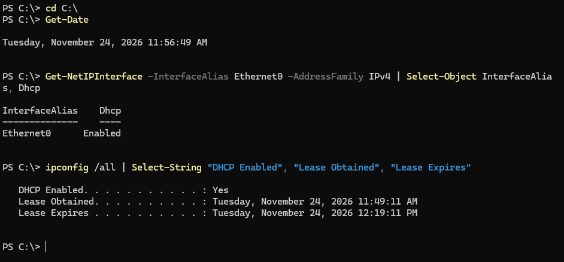

### DNS
- **Configuration (6:35:20 PM, VM clock):** one DNS server is configured on the IPv4 interface. The address is not recorded.
- **Test (6:47:01 PM, VM clock):** `Resolve-DnsName dnstest.invalid -Type A -DnsOnly`. The `.invalid` suffix is reserved and never resolves, and `-DnsOnly` stops Windows from falling back to LLMNR or NetBIOS. The command timed out (`OperationTimeout`, `ERROR_TIMEOUT`).
- **Capture (host clock):** 2026-11-24 18:46:26 to 18:49:32 (3 min 6 s), 120 packets.
  - 5 packets carried the query name `dnstest.invalid`, the first about 38 s in. I did not check which machine sent them.
  - **0 responses** to `dnstest.invalid`.
  - 6 packets matched `dns.flags.response == 1`, all successful answers sent by the host's VMnet1 adapter. All 6 were mDNS responses, and **0 were ordinary DNS responses**. 20 mDNS packets appeared in total.
- **SHA-256:** `e8ec6ecd159b4f5ec81396908098220134ef995da2bd930cde601cbe3d2ce3a7`
- **Reading:** nothing answered the VM's DNS query on the Host-only network in this capture, which matches the timeout. The mDNS answers are a separate protocol and outside the scope of this test. This is one capture of one name.
- A host-side check of what listens on UDP 53 was not recorded.

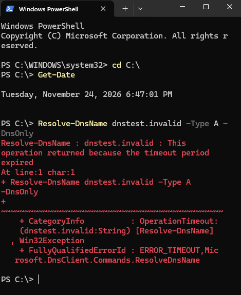

## Repeat Run (second pass, after the revert)

I repeated the NetBIOS and LLMNR before/after tests on the reverted VM (default settings, VMware Tools installed), using the same capture point, triggers and filters. SSDP was not repeated. Clock offsets were measured to the second: the VM clock was about 16 s ahead of the host before hardening (host 19:09:11, VM 19:09:27) and about 2 s ahead after the restart (host 19:42:43, VM 19:42:45).

### Baseline state (checked 2026-11-24 7:05:24 PM, VM clock)
`TcpipNetbiosOptions` = 0, NetBIOS over Tcpip Enabled, no `DNSClient` policy key. This is the same default state as the first baseline.

### Hardening (second pass)
All three changes were made in one elevated PowerShell window, and each worked on the first attempt, with no undo commands.

| Area | Change | Time (VM clock) | Read-back |
|---|---|---|---|
| NetBIOS over TCP/IP | `SetTcpipNetbios` with option 2 | 7:37:10 PM | `ReturnValue` 0; option 2; effective Disabled |
| LLMNR | `EnableMulticast` = 0 | 7:37:52 PM | 0 |
| SSDP / UPnP | SSDPSRV and upnphost set to Disabled | 7:38:15 PM | Stopped / Disabled |

The VM was then restarted once.

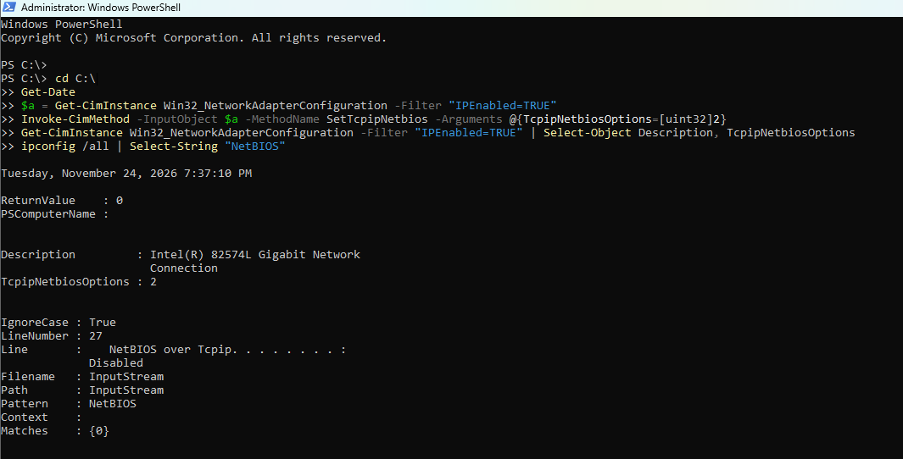
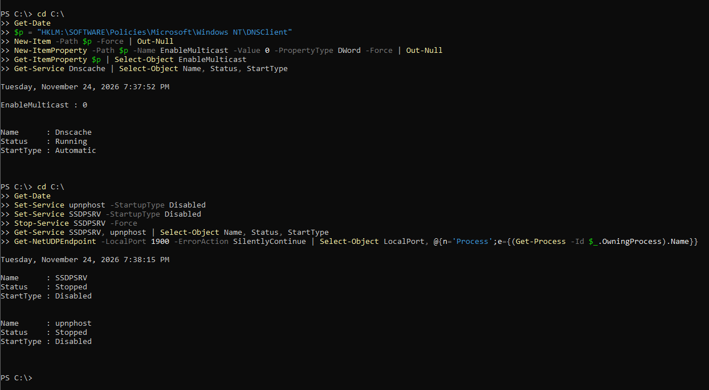

### After-state read-back (7:43:26 PM and 7:45:55 PM, VM clock)
`TcpipNetbiosOptions` = 2 with NetBIOS over Tcpip Disabled; no rows for UDP 137, UDP 138 or TCP 139; `EnableMulticast` = 0; Dnscache Running / Automatic; SSDPSRV and upnphost Stopped / Disabled; no rows for UDP 5355, TCP 5355, UDP 1900 or TCP 2869.

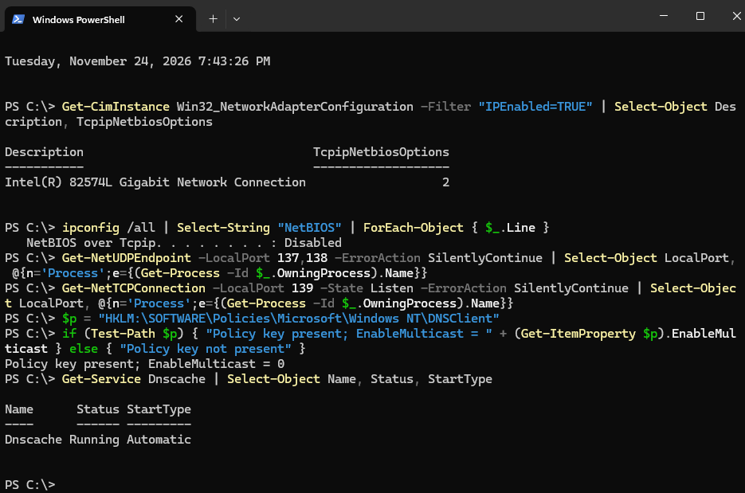
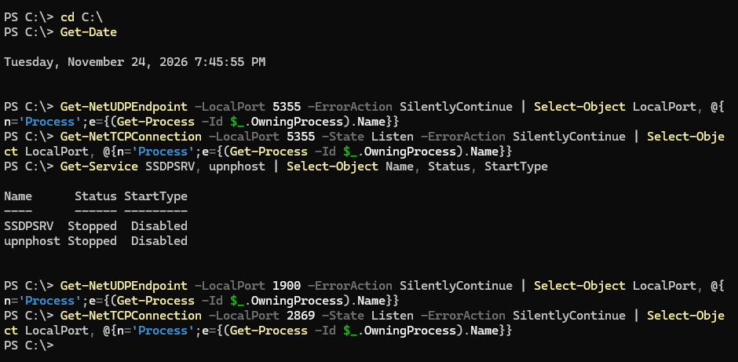

### Traffic

| Test | Capture (host clock) | Packets | Packets with the test name | Matches |
|---|---|---|---|---|
| NetBIOS, baseline | 2026-11-24 19:10:00 to 19:15:37 (5 min 36 s) | 120 | 23 (first at No. 20, about 35 s) | **3** NBNS name queries for `NBTEST-HOST01<00>`, sent by the VM |
| NetBIOS, hardened | 19:49:02 to 19:55:05 (6 min 3 s) | 96 | 15 (first at No. 9, about 63 s) | **0** |
| LLMNR, baseline | 19:21:03 to 19:27:00 (5 min 57 s) | 85 | 23 | **8** LLMNR queries for the test name (4 A, 4 AAAA), all sent by the VM |
| LLMNR, hardened | 19:58:17 to 20:03:27 (5 min 10 s) | 124 | 15 (first at No. 7, about 53 s) | **0** for the test name |

- In the hardened LLMNR capture, 8 other LLMNR-port packets appeared. All were queries for the host computer's name (not published), sent by the host's own VMnet1 adapter. **0 came from the VM.**
- Ordinary DNS responses (`dns.flags.response == 1 && !mdns`): 0 in all four captures.
- SHA-256 (captures kept private): NetBIOS baseline `202f4ed1c6a9251ec5810f13e478ca791a812a0a7776a4918bbb8adb8baf10c3`; LLMNR baseline `ed27b6f541afcfe5517b7c416ce9e73e182afefad4c33487feda63a7d8f318b6`; LLMNR hardened `cf05b583ea3013be06b76fb6e491c7792714f2c129a2e39145b90df475368876`; NetBIOS hardened not recorded.

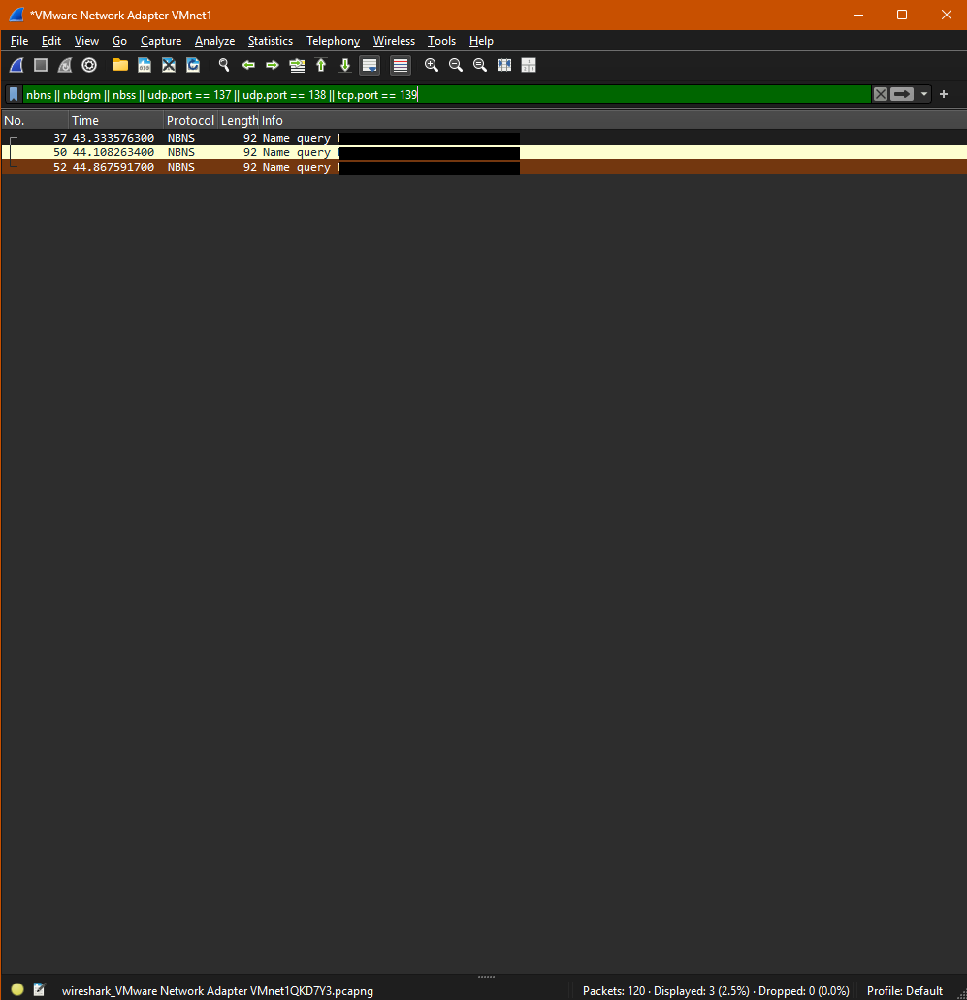
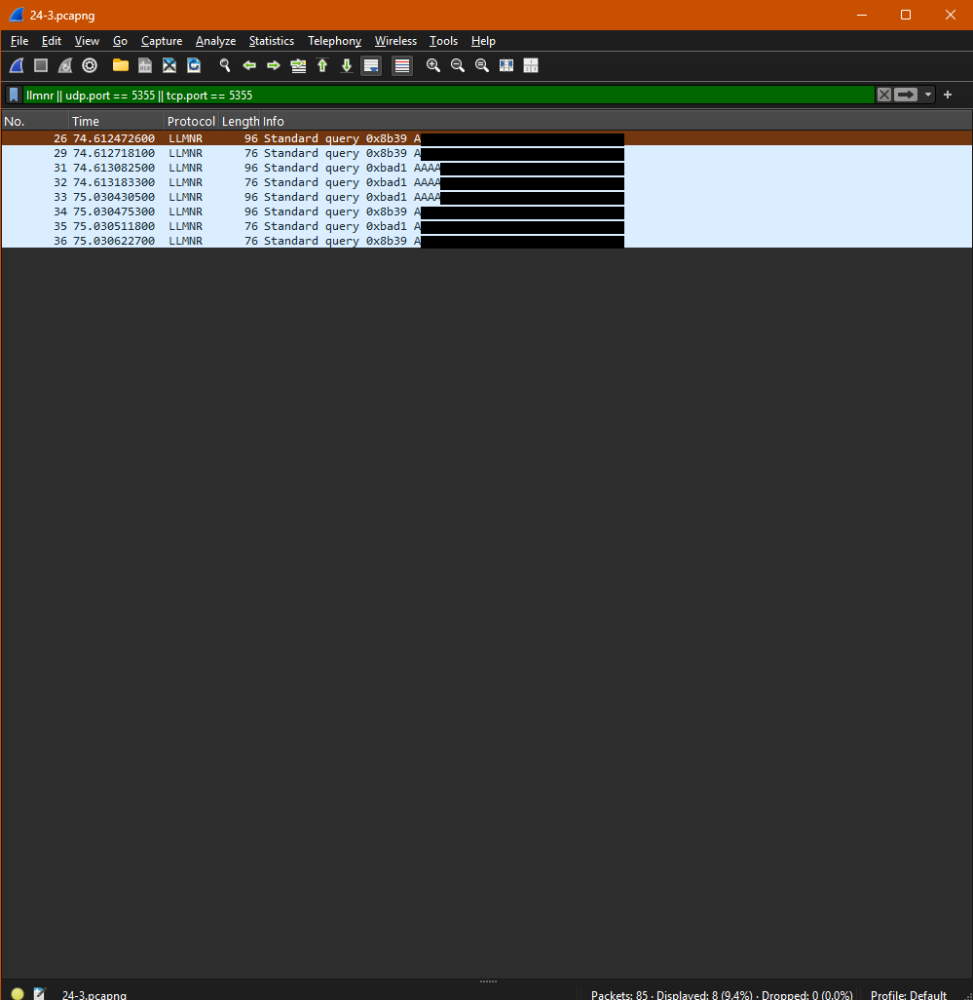
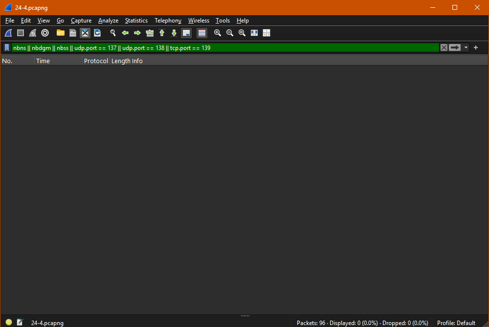
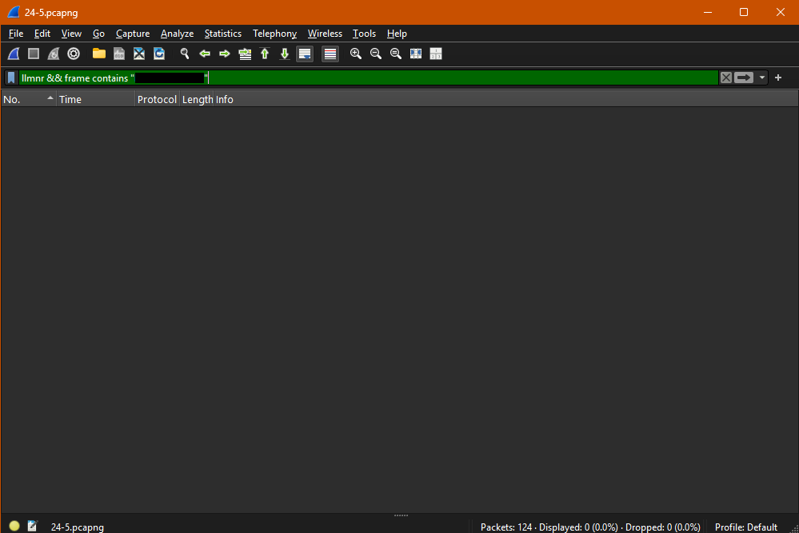

### Reading the repeat
Both passes gave the same outcome: the VM sent NBNS and LLMNR queries for the test names on the default configuration, and none after hardening, with the trigger present in each capture. The host adapter's own LLMNR queries are separate from the VM's. The repeat does not prove the traffic can never appear.

### State after the repeat
The VM was left hardened: NetBIOS over TCP/IP disabled, `EnableMulticast` = 0, and SSDP Discovery and UPnP Device Host disabled.

## Study Notes

- **NetBIOS over TCP/IP** uses UDP 137 for name service, UDP 138 for datagrams and TCP 139 for sessions. When a short name can't be resolved, a machine can broadcast an NBNS name query on the local network, which is what the baseline capture showed. With NetBIOS over TCP/IP disabled, name resolution relies on DNS and file sharing uses SMB directly over TCP 445. Microsoft's own guidance says to check that nothing depends on NetBIOS before turning it off.
- **LLMNR** is a secondary name-resolution protocol. When DNS can't resolve a name, a Windows machine can ask other machines on the same link using multicast. The "Turn off multicast name resolution" policy disables it and writes `EnableMulticast` = 0 under the `DNSClient` policy key, which is the value this lab set and read back. The security reason to disable it is that another machine on the same network could answer these queries.
- **SSDP** is the discovery half of UPnP. A client asks the network which devices exist with an `M-SEARCH` message, and devices announce themselves with `NOTIFY`. Both use multicast on UDP 1900. In this lab, the `M-SEARCH` packets on the Host-only network came from the host's own adapter, not from the VM.
- **Reading captures:** zero matching packets only means something if the trigger is in the capture, so I confirmed the test name appeared in each capture before interpreting a zero. Attributing every matching packet to its sender (the VM or the host's VMnet1 adapter) mattered, because the host adapter generated LLMNR and SSDP traffic too.
- **Process:** I made changes one at a time with a read-back after each, and a mistaken undo command showed why the read-back after the restart was needed.

## Safety and Scope

- All testing stayed inside my own VM on a Host-only network, with no bridged or NAT networking and no public or third-party systems.
- Read-only checks came first. Each change had a recorded purpose, expected effect and undo path.
- The `pre-hardening-baseline` snapshot was the rollback point and was used for the cleanup.
- IP, MAC and IPv6 addresses and the host computer's name are not published.
- An AI assistant guided the order of steps and reviewed my screenshots for sensitive information. I ran every command, recorded every result, and obscured the images myself.

## Evidence

`01`, `01b`, `02`, `03`, `04`, `05`, `05a`, `06`, `07`, `08`, `08a`, `09`, `10`, `11`, `12`, `12a`, `13`, `13b`, `13c`, `14`, and for the repeat run `05r`, `07r`, `11r`, `11ra`, `12r`, `12ra`, `13r`, `13br` (all images shown above, in `screenshots/`).

The SHA-256 values were read from Wireshark's Capture File Properties for the original capture files. The captures themselves are not published.

## Limitations

- Each traffic result is a single capture with one trigger. NetBIOS and LLMNR were repeated once (see Repeat Run); the other tests were not. Zero matching packets does not prove a protocol is permanently absent.
- Capture lengths differed between before and after (for example 5 min 42 s against 5 min 9 s), and total packet counts differ noticeably. The reason is not established.
- Isolation is supported by VMware settings and 0 DNS responses in the captures, not by a direct reachability test from the guest.
- The SSDP captures cannot show an effect, because the VM sent no SSDP at baseline. A trigger that makes the VM search for devices was not tested.
- The host's own VMnet1 adapter also generated LLMNR and SSDP traffic. Packets were attributed by sender, and only some host-name queries were inspected individually.
- The VM clock offset from the host changed between sessions (see Environment), and the cause is not established. Events are ordered through trigger packets and the snapshot order, not through the two clocks. After the revert, the clocks agree to within a few minutes in the readings taken. The VMware Tools time synchronization was off.
- The cleanup read-back was taken after the VMware Tools install, and listeners were not re-checked afterwards.
- The Windows release channel is not established, and the VM was not updated.
- Windows Firewall and Defender were not tested. DHCP and DNS were checked once, after the revert, and were not hardened or compared before and after.
- The guest isolation check reads the routing table at one moment. It is not a connectivity test.
- The repeat run was done on the reverted VM with VMware Tools installed, so it is not identical to the first pass. The SHA-256 of the hardened NetBIOS repeat capture was not recorded, and in the NetBIOS repeat baseline the first packet with the test name appeared about 25 s after the recorded ping time; the cause is not established.
- mDNS queries appeared in the baseline captures. mDNS is outside the three areas in this lab, so it was not analysed, attributed or hardened.
- Disabling NetBIOS over TCP/IP, LLMNR and SSDP/UPnP can break legacy name resolution, NetBIOS file sharing and UPnP device discovery. Nothing in this isolated lab depended on them.

## Next Steps

- Optional: test SSDP with a trigger that makes the VM send discovery traffic.
- Optional: re-check listeners after a revert, without installing other tools first.

## Real-World Considerations (not performed in this lab)

- **Why these protocols matter:** MITRE ATT&CK describes name-resolution poisoning (T1557.001), where another machine on the same network answers LLMNR or NBT-NS queries to collect or relay authentication material. MITRE lists disabling LLMNR, mDNS and NetBIOS where they aren't needed as a mitigation.
- **Scale:** on managed devices, these settings would normally be deployed by Group Policy or device management, not by hand. The CISA page in the references describes the Group Policy setting for LLMNR. I did not test any centrally managed deployment here.
- **Compatibility:** Microsoft's guidance is to check for legacy applications and clients that depend on NetBIOS before disabling it. This lab had no such dependencies.
- **Related traffic:** mDNS queries appeared in the captures and were not addressed (see Limitations).

## Appendix A: Process Notes

- **NetBIOS, first two attempts:** two attempts to disable NetBIOS did not change the setting. The first was in a PowerShell window that was not elevated. The cause of the second, made through the adapter's settings window, is not established. The third attempt, in an elevated window, succeeded (`ReturnValue` 0, then `TcpipNetbiosOptions` = 2).
- **Mistaken undo commands:** undo commands were run by mistake after the LLMNR change and before the SSDP/UPnP change. They removed the `EnableMulticast` value (confirmed empty at 4:39:01 PM) and reset the SSDP/UPnP services to Manual. The LLMNR policy was set again at 4:39:52 PM, and the SSDP/UPnP services were set to Disabled at 4:30:25 PM. The read-backs after the restart confirm the final state.
- **Screenshots kept private:** the original screenshots that mixed change and undo commands are not published. The LLMNR change is evidenced by the clean screenshot taken at 4:39:52 PM.
- **A reading from the wrong window:** during the repeat run, one read-back was taken in a PowerShell window on the host by mistake (about 7:43:37 PM). It showed the host's own SSDP Discovery service running and UDP 5355 and UDP 1900 bound by `svchost`. That describes the host, not the VM, and is consistent with the host adapter sending LLMNR and SSDP traffic on VMnet1. The image is not published, and the VM's read-back was repeated in the VM at 7:45:55 PM.

## References

Several of these Microsoft pages describe older Windows versions, so they were used for how the protocols work, not for the exact steps on Windows 11.

- Microsoft Learn, *NetBIOS Over TCP/IP* (Windows 2000 documentation): https://learn.microsoft.com/previous-versions/windows/it-pro/windows-2000-server/cc940063(v=technet.10). Lists the NetBIOS ports (UDP 137 and 138, TCP 139), notes that direct hosting uses TCP 445, and warns that applications depending on NetBIOS stop working when it is disabled.
- Microsoft Learn, *How to configure TCP/IP networking while NetBIOS is turned off* (Windows Server 2003): https://learn.microsoft.com/en-us/troubleshoot/windows-server/networking/configure-tcpip-networking-netbios-turn-off. Describes turning NetBIOS over TCP/IP off from the WINS tab of the adapter's advanced settings, and recommends testing before doing so in production.
- CISA, *Disable Link-Local Multicast Name Resolution (LLMNR) Service (CM0053)*: https://www.cisa.gov/eviction-strategies-tool/info-countermeasures/CM0053. Explains that disabling LLMNR helps disrupt LLMNR poisoning, and shows the policy value `EnableMulticast` = 0 under the `DNSClient` policy key.
- IETF, RFC 4795, *Link-Local Multicast Name Resolution (LLMNR)*: https://www.rfc-editor.org/rfc/rfc4795. The specification for the protocol.
- Open Connectivity Foundation, *UPnP Device Architecture 2.0*: https://openconnectivity.org/upnp-specs/UPnP-arch-DeviceArchitecture-v2.0-20200417.pdf. The specification covering SSDP discovery, including `M-SEARCH` and `NOTIFY`.
- Microsoft Learn, *Discovery and Description* (Windows CE 5.0): https://learn.microsoft.com/en-us/previous-versions/windows/embedded/aa456291(v=msdn.10). Shows SSDP `NOTIFY` and `M-SEARCH` messages sent to port 1900 and UPnP device-host content served on port 2869.
- MITRE ATT&CK, *Adversary-in-the-Middle: Name Resolution Poisoning and SMB Relay* (T1557.001): https://attack.mitre.org/techniques/T1557/001/. Describes how attackers abuse LLMNR and NBT-NS, and lists disabling LLMNR, mDNS and NetBIOS where not needed as a mitigation.
