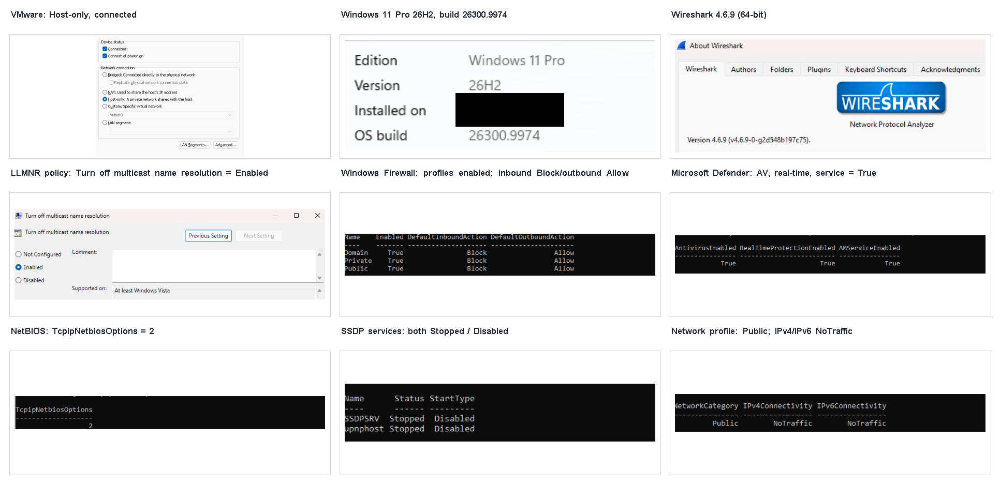
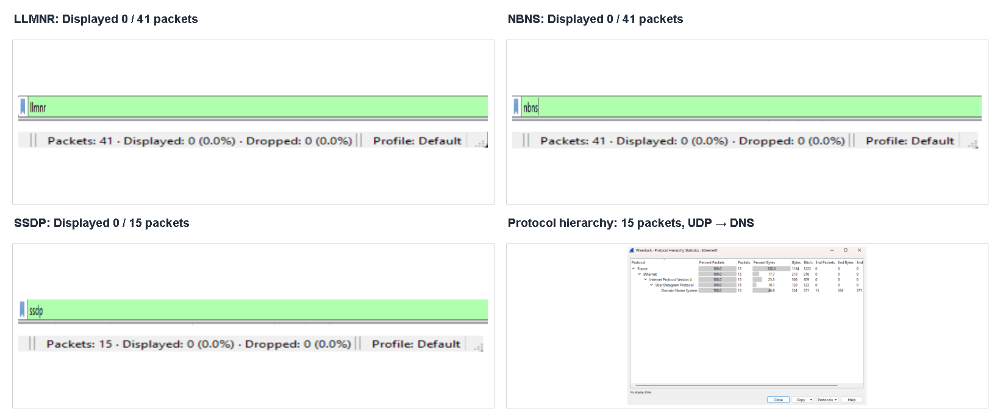
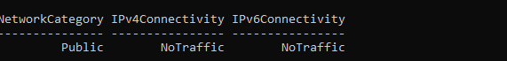
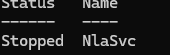
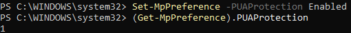

# Name Resolution and Discovery Protocols — Lab Study Guide

> **Draft: historical protocol-hardening observations plus a later baseline review and one additional hardening change.** Older NetBIOS, LLMNR, and SSDP/UPnP findings are kept distinct from the later Windows 11 follow-up. In that follow-up, Microsoft Defender PUA protection was changed from Audit to Enabled and the configuration was verified. PUA blocking behavior was not tested. [Lab study template](../../../../LAB-STUDY-TEMPLATE.md).

## Key Results

- The older lab recorded baseline and after-state observations for NetBIOS, LLMNR, and SSDP/UPnP. Those historical observations are summarized separately from the later follow-up.
- In the older evidence, NetBIOS changed from enabled to disabled; LLMNR after-state checks showed the policy value set to `0x0`, no matching packets, and no UDP/5355 listener; SSDP after-state checks showed `SSDPSRV` stopped/disabled and no matching traffic.
- The later follow-up found Windows Firewall profiles enabled with inbound traffic blocked by default, Microsoft Defender protections enabled, and the prior NetBIOS/LLMNR/SSDP settings still in their hardened states.
- Microsoft Defender Potentially Unwanted Application (PUA) protection was changed from Audit to Enabled during the later follow-up. A configuration read-back confirmed **Enabled**.
- A DNS lookup for `example.com` timed out. The cause was not established.
- Historical DHCP observations differ: an older DHCP ACK showed a 3600-second lease, while a later read-only summary reported 30 minutes. The discrepancy was not reconciled.
- The screenshots below are sanitized evidence excerpts from the later follow-up, not a complete record of every historical observation. Raw packet captures are not included.

## Sanitize First

- Use an isolated, owned lab and synthetic test names.
- Review screenshots before sharing. Do not publish raw packet captures, private network identifiers, credentials, internal hostnames, or personal data.
- The later name-resolution test used `LAB-NO-SUCH-HOST`; the DNS lookup used `example.com`.

## Objective

Assess Windows host name-resolution and service-discovery configuration, compare historical baseline and after-state observations, and add later firewall, Defender, network-profile, and DNS observations without merging separate runs or implying unverified causes.

## Environment

- **Virtualization:** VMware Workstation; the later follow-up used a Host-only adapter. No bridged adapter was shown.
- **Guest operating system:** Windows 11 Pro, version 26H2, build 26300.9974, during the later follow-up. Older protocol evidence was captured on an earlier Windows build; treat it as a separate observation period.
- **Packet analyzer:** Wireshark 4.6.9 (64-bit) during the later follow-up.
- **Network profile:** Public during the later follow-up. PowerShell reported `NoTraffic` for both IPv4 and IPv6. `NlaSvc` was stopped when checked; this is a co-occurring observation, not an established cause.
- **Safety:** A VMware snapshot was created before the later PUA change. Testing was performed in the isolated VM.

## Findings / Baseline

### Historical protocol-hardening evidence

| Area | Earlier baseline | Earlier after-state |
|---|---|---|
| NetBIOS over TCP/IP | Configuration showed enabled; the `nbns` filter displayed 3 matches in the captured window. | Configuration showed disabled; the `nbns` filter displayed 0 matches in a 324-packet capture window. |
| LLMNR | The `llmnr` filter displayed 8 matches in a 187-packet capture window; a UDP/5355 listener was also observed. | The policy registry query showed `EnableMulticast` as `0x0`; the filter displayed 0 matches in a 357-packet window, and a later listener check returned no UDP/5355 result. |
| SSDP / UPnP | The `ssdp` filter displayed 12 matches in the earlier capture; `SSDPSRV` was running and a UDP/1900 listener was observed. | The troubleshooting notes and after-state evidence report `SSDPSRV` stopped/disabled, no UDP/1900 listener, and 0 `ssdp` matches in a 186-packet capture window. |

These are observations from the older evidence set. Packet totals describe only the captured windows and do not prove that the protocols can never appear.

### Later follow-up observations

| Area | Observation |
|---|---|
| Windows Firewall | Domain, Private, and Public profiles were enabled. Effective default inbound action was `Block`; outbound action was `Allow`. |
| Microsoft Defender | Antivirus, real-time protection, and antimalware service were enabled. |
| NetBIOS over TCP/IP | `TcpipNetbiosOptions` was `2` (disabled) on the active virtual adapter. Read-only endpoint checks returned no output for UDP 137/138 or TCP 139. |
| LLMNR | Group Policy **Turn off multicast name resolution** displayed **Enabled**, meaning LLMNR was disabled by policy. A registry query produced no output; no registry value is claimed for this follow-up. |
| SSDP / UPnP | `SSDPSRV` and `upnphost` were both `Stopped`, with startup type `Disabled`. Read-only UDP endpoint checks returned no output for ports 1900 and 5355. |
| Short Wireshark observations | The `llmnr` and `nbns` filters each showed 0 matches in a 41-packet capture window. The `ssdp` filter showed 0 matches in a separate 15-packet window. These results apply only to those windows. |
| Protocol hierarchy | The 15-packet SSDP-test capture was classified as UDP → DNS. This is a protocol breakdown of that capture, not evidence that DNS resolution succeeded. |
| DHCP | The later capture showed a DHCP Request and ACK. A separate read-only configuration summary reported a 30-minute lease; that duration is not inferred from the packets. This differs from the 3600-second lease shown in the older ACK evidence. |
| DNS and network configuration | A DNS server was configured, and no default gateway was present. A lookup for `example.com` timed out with `ERROR_TIMEOUT`. |
| DNS connectivity checks | `Test-NetConnection` reported `PingSucceeded: False` and `TcpTestSucceeded: False` for the configured DNS server. These results do not establish whether DNS over UDP is reachable. |
| PUA protection | The preference was in Audit mode before the later hardening change. |

## Action / Hardening

The older lab's recorded hardening outcomes were NetBIOS disabled, the LLMNR `EnableMulticast` policy value at `0x0`, and `SSDPSRV` stopped/disabled. The historical evidence does not preserve every command or change step, so this report does not present them as a reproducible procedure.

During the later follow-up, Microsoft Defender PUA protection was in Audit mode. It was changed to Enabled, and a follow-up read-back confirmed **Enabled**. No other settings were changed during that follow-up. This does not negate the separate protocol hardening documented from the older lab.

## Verification

The later read-back verifies the PUA configuration only; no PUA sample was run, so detection and blocking behavior were not tested. The later follow-up also rechecked the hardened NetBIOS, LLMNR, and SSDP/UPnP configuration and observed short zero-match capture windows.

The older DHCP ACK and historical protocol packet counts are summarized from the older evidence set and are not shown in the screenshots below. The later DHCP Request/ACK, 30-minute lease, DNS lookup timeout, and DNS-configured/no-gateway summary are text-reported observations; they are also not shown in the screenshots below.

### Sanitized Evidence

#### Windows 11 baseline settings

*Look for: the later follow-up's firewall, Defender, name-resolution policy, service, and network-profile settings.*

#### Wireshark protocol filters and hierarchy

*Look for: the later follow-up's displayed filter results and protocol breakdown for short capture windows.*

#### Network profile and connectivity

*Look for: the Public profile and `NoTraffic` connectivity values observed during the later follow-up.*

#### Network Location Awareness service status

*Look for: the stopped service status observed during the later follow-up.*

#### DNS server connectivity checks

*Look for: failed ping and TCP connectivity checks; these do not test DNS over UDP.*

#### PUA protection hardening and verification

*Look for: the later follow-up's change and read-back. This is a cropped verification excerpt, not complete lab evidence.*

## Limitations and Lessons Learned

- Historical and later observations are from different Windows builds and observation periods; they are reported separately.
- Historical packet counts and later zero-match counts apply only to their capture windows; they do not prove a protocol can never be used.
- The historical report preserves selected outcomes but not every change command or full capture, so it is not a complete reproduction guide.
- A configured DNS server does not establish that it is reachable. Failed ping and TCP/53 checks do not determine whether DNS over UDP works.
- The cause of the DNS timeout was not established.
- The Public profile, `NoTraffic` connectivity values, and stopped `NlaSvc` status were observed together; no causal relationship was established.
- DHCP evidence conflicts across observation periods: the older ACK showed 3600 seconds, while the later summary reported 30 minutes. The difference was not reconciled.
- The PUA preference was verified by configuration read-back. PUA blocking behavior was not tested.
- Packet captures were discarded and are not included as evidence. An earlier accidental capture screenshot exposed private network identifiers and was not reused.

## Next Steps

- Test whether DNS over UDP works in the isolated lab without assuming the result from the ping or TCP/53 checks.
- Investigate the Public profile using read-only checks; treat the stopped `NlaSvc` status as an observation, not a confirmed cause.
- If repeating protocol observations, use longer, controlled capture windows and record the trigger and filter for each one.
- Reconcile the different DHCP lease observations only if a dated capture or configuration record establishes why they differ.

## Study Notes

- Distinguish configuration state from observed network behavior.
- NBNS and LLMNR are local name-resolution mechanisms; SSDP supports service discovery; DHCP provides network configuration; DNS resolves domain names.
- LLMNR and NBNS are commonly disabled in hardening guidance because local name-resolution traffic can be susceptible to spoofing.
- Record limitations alongside packet counts and configuration checks.

## References

- [Lab study template](../../../../LAB-STUDY-TEMPLATE.md)
- [Privacy and sanitization notes](windows-network-hardening/docs/privacy-and-sanitization.md)
- [Troubleshooting notes](windows-network-hardening/docs/troubleshooting.md)
- [Microsoft Defender PUA protection](https://learn.microsoft.com/defender-endpoint/detect-block-potentially-unwanted-apps-microsoft-defender-antivirus)
- [Wireshark User's Guide](https://www.wireshark.org/docs/wsug_html/)
